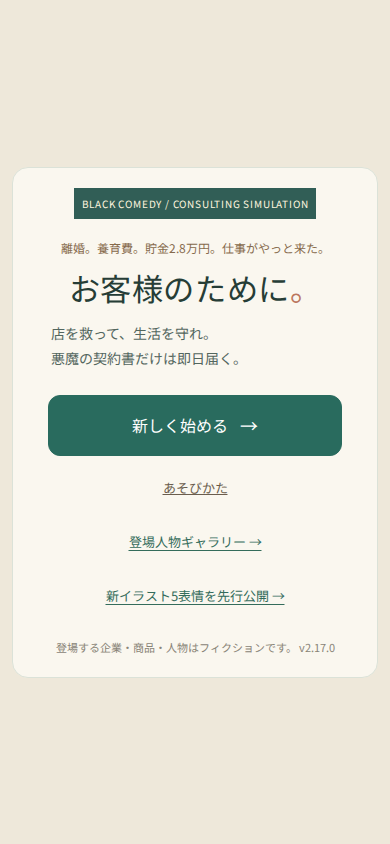
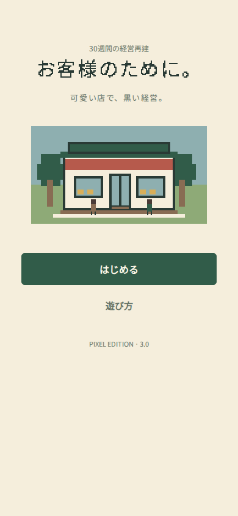
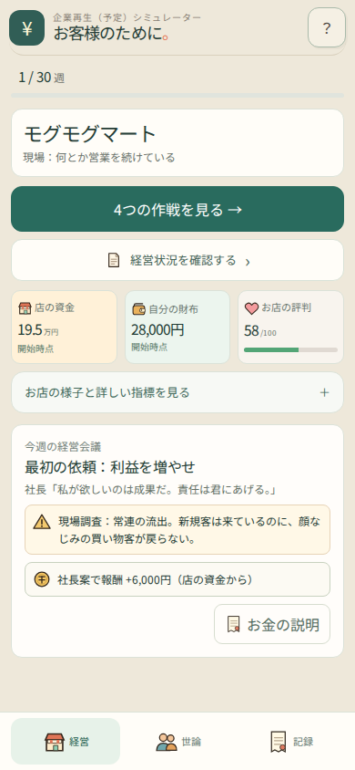
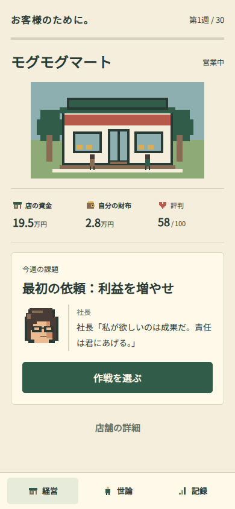
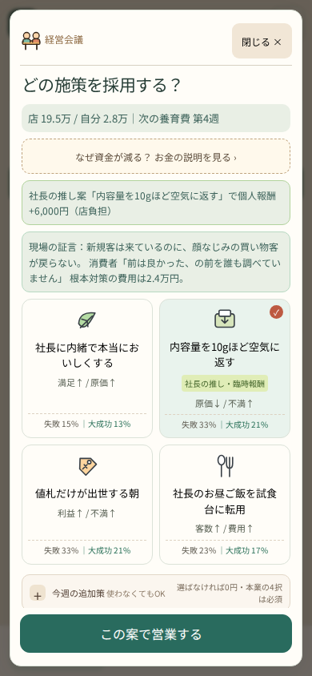
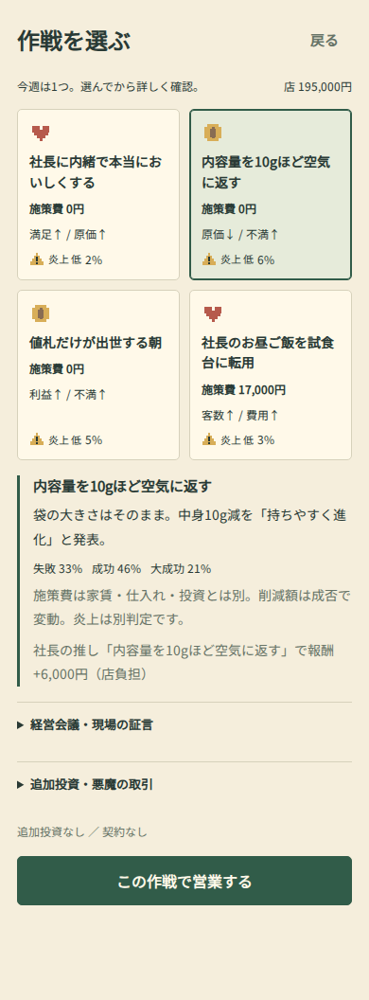
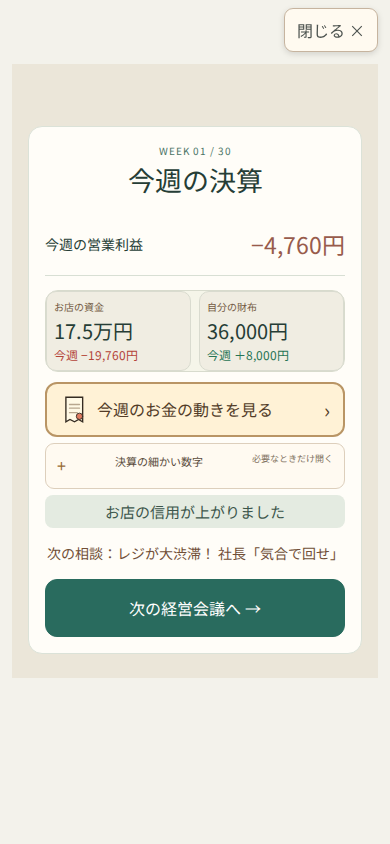
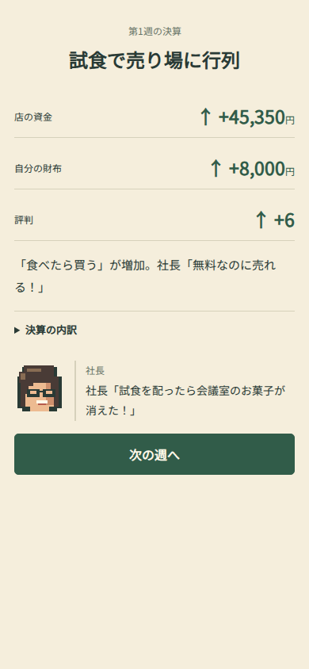

# 390px comparison

Baseline is main 41901f2. After images are the Pixel Edition release, from actual browser rendering.

| Screen | Before | After |
|---|---|---|
| Title |  |  |
| Home |  |  |
| Choices |  |  |
| Weekly report |  |  |

The report screenshots use different simulated weeks and therefore are layout comparisons, not a claim of identical financial outcomes. Economy preservation is tested independently by exact file hashes and deterministic engine regression tests.
