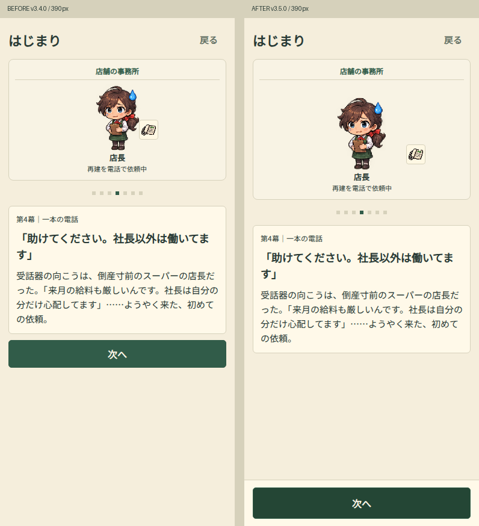
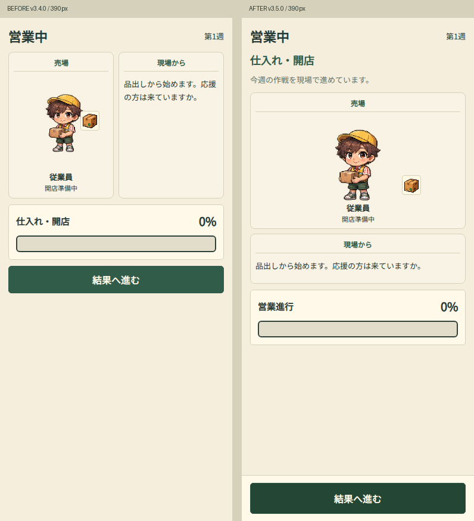
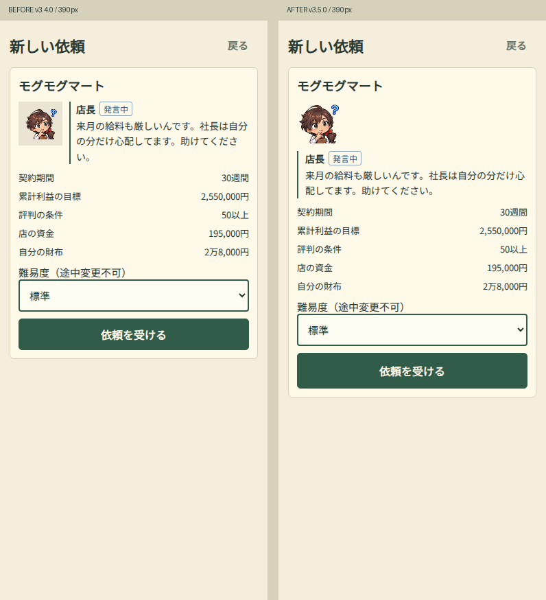
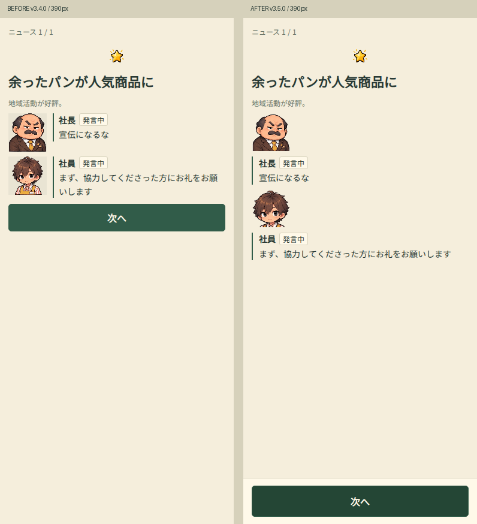
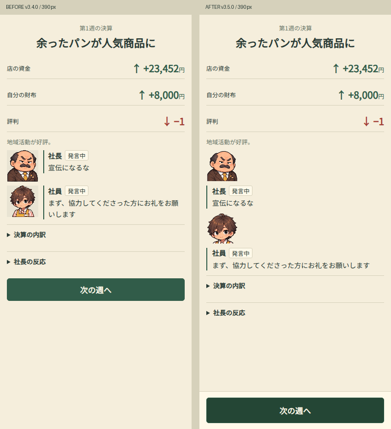
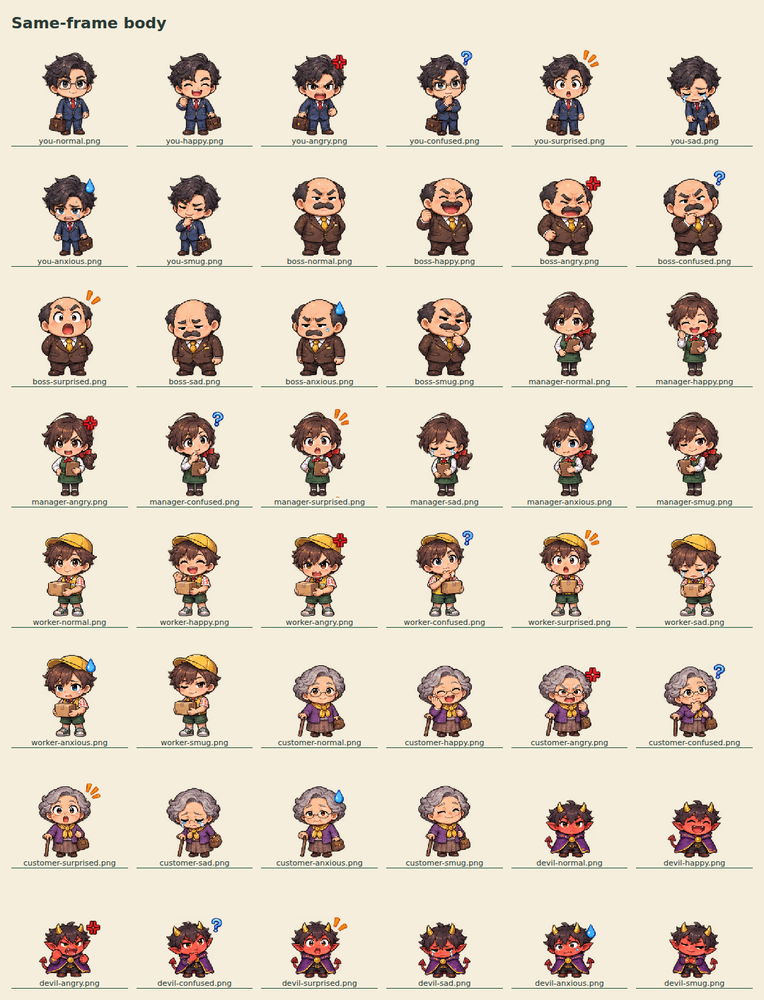
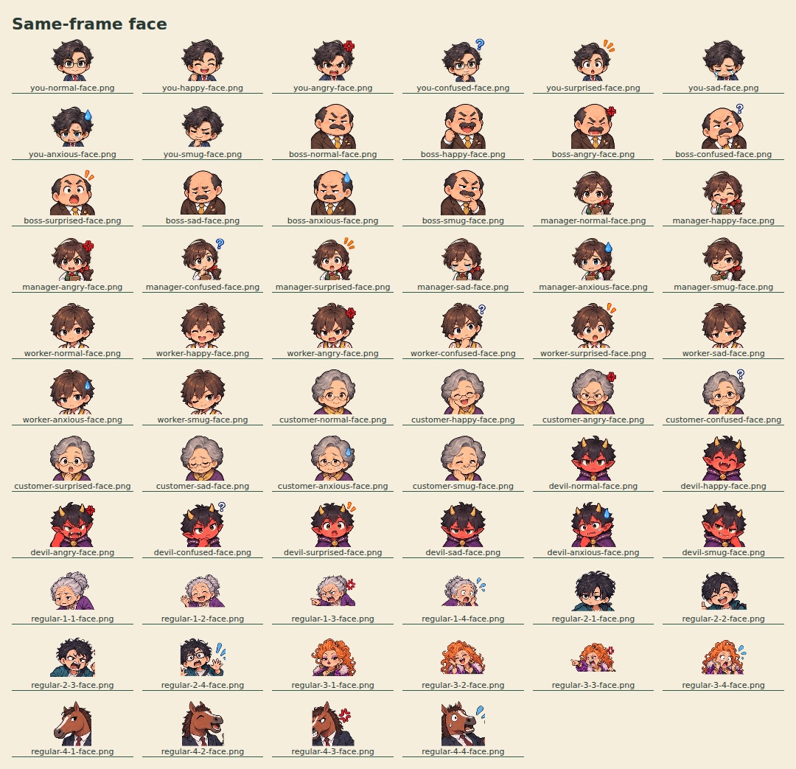
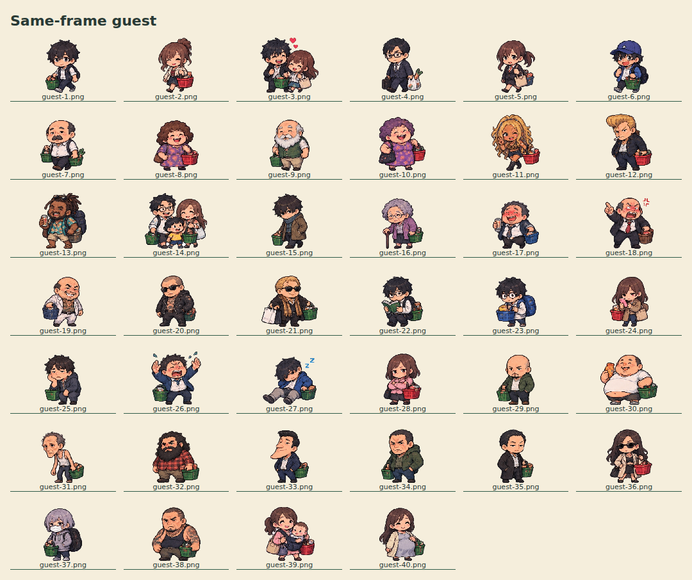

# v3.5.0 人物スケール・CTA・視線導線

基準: main `15515d483af147d91e0fe05e985576d4a5d9fcd6` / v3.4.0。
公開先: https://reyanyan0126.github.io/okyakusama-game/

## サイズとCSS

旧指定は `.character` の96×128→72×96→96×160、`.working .character` の48×64→60×80→96×160、`.actor-task .character` 高さ112、営業160、顔64→32/56（狭幅）→96→64、顧客高さ80→112→営業160、幅clamp/90px上限が競合していた。

全CSSの同一セレクタを統合し、サイズは `.character` / `.portrait` / `.guest` の各1定義へ集約。後段の人物サイズ上書きは廃止。レスポンシブ指定は列構成・余白・文字サイズのみ。

|用途|表示枠|画像と基準|
|---|---|---|
|全身|高さ144px、幅は縦横比に従う|256×224。全主要人物で元の1pxを同じ縮尺で表示し足元を下端へ|
|会話の顔|64×64px|顔専用128×128 PNG。縦横比を保持|
|買い物客|高さ96px、幅は縦横比に従う|280×224。全40素材で同じ縮尺、横幅で人物を縮小しない|

全身144pxは枠の高さであり、全員の頭を144pxまで引き伸ばす意味ではない。森さんの小柄な体格、悪魔の低い身長、買い物客の体格差や親子の構成は維持する。足元が動く旧上下アニメーションは停止。画像の表情差分は維持。

`assets/ui/` の152枚は元画像から再現生成。主要全身48、主要顔48、一般客40、特殊客顔16。元の `assets/cast/` と `assets/work-import/` は変更なし。透明に近い外周ノイズをサイズ判定から除外、視認できる小さな孤立点を除外して余白を補正。髪・帽子・手足・道具は全身で保持。顔画像は意図的に頭・肩を切り出す。特殊客は全身を64pxへ縮小していた経路を廃止。手動確認した頭領域はスクリプトに明示。

再生成: `python scripts/normalize-ui-art.py`（Pillow）。元画像・トリミング領域・出力領域は `assets/ui/manifest.json`。

## CTAの採否と読む順序

|画面|CTA|主役・順序|
|---|---|---|
|タイトル|通常|店の入口→開始/再開/遊び方|
|依頼|通常|店長の説明→条件→難易度→依頼受諾。選択内容を確認して押す|
|導入1〜7|下部固定|場所→人物と行動→幕見出し→本文→次へ。7幕個別検証|
|ホーム|既存ナビのみ|資金と評判→今週の課題と作戦ボタン→売場の仕事。縦積みで操作が埋もれない順序|
|店舗詳細|通常+既存ナビ|指標→証言→必要時のみ常連会話|
|作戦選択/会議/追加投資/悪魔契約|通常|4択・条件・費用の文脈を保持。「営業する」を機械的に固定しない|
|営業|結果へ進むを下部固定|営業フェーズ→状況→担当人物・行動→客または現場報告→進行バー|
|結果|下部固定|成否→施策→本文→任意詳細→ニュース/決算|
|通常ニュース/炎上/悪魔の支払イベント|下部固定|ニュース見出し→関係者→内容→次へ|
|クレーム・事故対応|通常|説明と費用→補償する/しない。2択の文脈を保持|
|資金ショート|通常|再建条件→救済の選択|
|決算/エンディング直前|下部固定|利益・資金→台帳→任意詳細→次週/結末|
|世論|既存ナビのみ|森さんの声→匿名口コミ|
|エンディング|通常|評価・数字→物語→再開/記録。2つの行先を残す|
|記録/登場人物/遊び方/財務|通常|情報・見本・保存やタブ操作を文脈の中に残す|

320〜430pxでは売場と客/現場報告、顔とセリフを縦積み。768px以上では売場の同時進行と会話の横並びを許可。4つの作戦は比較目的のため2列を維持。

CTAは52px高、固定バーは上下12pxと `env(safe-area-inset-bottom)`。本文にバー高+20pxの下余白。既存ボタンを移動するだけでイベント処理を維持。固定CTAの対象を明示し、事故ニュースには生成しない。固定ナビとの同時表示なし。

方式比較: stickyは短文時の位置が内容末尾に依存し、本文内スクロール方式は既存の復帰・フォーカス処理を大きく変える。このため本文は従来のページスクロール、CTAのみviewport固定を採用。Safariのフォーム選択を含む画面は対象外。

## 実画面比較

下の画像は390px・同一テストシナリオ。左v3.4.0、右v3.5.0。スクロールのある画面はページ全体を保存している。

同じCSS枠に全主要人物48表情、顔64種、一般客40素材を配置し、ブラウザ描画を目視確認。

## 検証と制限

- 単体/回帰テスト34件。追加3件は素材とオフライン登録、サイズ指定の一元性、単一CTAの対象制限。
- 新規レイアウトテスト: Chromium/WebKitの320/375/390/430/768。長文化、末尾到達、CTA座標、Safe Area 34px相当、ナビ競合、縦積み、画像縦横比・足元、導入7幕、事故の通常2択を検査。
- 既存全画面テスト: 320/375/390/430/768/1024で30週進行、特殊イベント、旧セーブ、全8結末などを維持。
- PWA: v3.4.0の実キャッシュから更新しセーブ完全一致・未読結果の再開を確認。画像152枚を新キャッシュに登録。
- 計算/財務/乱数/セーブ関連のengine.js、finance.js、management.js、stories.js等は変更しない。
- ローカルWebKitはシステムライブラリ不足。GitHub Actions公式Playwrightコンテナで実行し、その実行結果をPRに記録する。
- iPhone実機は未検証。WebKitの指定幅・Safe Area相当の幾何検証と実機Safariは区別する。
- 公開ファイル一致と公開URLの両エンジン検証結果はPRの公開完了欄を最終記録とする。
